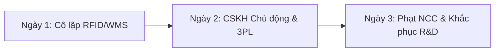

# BÁO CÁO PHÂN TÍCH & KẾ HOẠCH XỬ LÝ SỰ CỐ Z101 - ZARA CHÂU Á

**Kính gửi:** CEO Khu vực Châu Á  
**Người báo cáo:** Chuyên gia Dữ liệu (Data Expert)  
**Ngày:** 29/09/2026 | **Định dạng:** Markdown (.md)

---

## I. EXECUTIVE SUMMARY & PHÂN TÍCH DỮ LIỆU

### 1. Bất thường Dữ liệu Trọng yếu
Hệ thống giám sát vận hành phát hiện sự cố chất lượng nghiêm trọng tại thị trường Châu Á đối với mã **Áo khoác Đỏ Z101**. Phản hồi chính từ người mua: **"Khóa ngược dễ kẹt"**.

* **Áo khoác Z101 (Châu Á):** Bán 500 | Trả 150 | **Tỷ lệ hoàn trả: 30,0%** 🔴 *(Báo động P0)*
* **Áo thun Z102 (Châu Âu - Mẫu an toàn):** Bán 1.200 | Trả 12 | **Tỷ lệ hoàn trả: 1,0%** 🟢

> **Đánh giá chuyên gia:** Tỷ lệ hoàn trả của Z101 cao gấp **30 lần** so với tiêu chuẩn an toàn (1,0%). Với 150/500 áo bị hoàn trả, 350 áo còn lại trong hệ thống có nguy cơ lỗi 100%. Đây là lỗi hệ thống trong khâu thiết kế và phụ kiện.

### 2. Phân tích Nguyên nhân Gốc rễ (Root Cause Analysis - 5 Whys)
* **Tỷ lệ trả hàng cao (30%)** $\rightarrow$ Khóa kéo ngược bị kẹt liên tục ở vị trí cổ và ngực.
* **Nguyên nhân kỹ thuật:** R&D sử dụng dòng khóa ngược (Reverse Zipper) có răng khóa quá khít với nẹp vải che.
* **Nguyên nhân gốc rễ (Root Cause):** Quy trình kiểm định QC của R&D thiếu bài kiểm thử độ bền cơ khí trong điều kiện nhiệt độ và độ ẩm cao tại khu vực Châu Á.

---

## II. ACTION PLAN: LỘ TRÌNH 3 NGÀY XỬ LÝ KHỦNG HOẢNG

### 🗓️ NGÀY 1: CÔ LẬP DỮ LIỆU & KHÓA TỒN KHO (T0 - T+24H)
* **Khóa tồn kho tức thì (T+2h):** Kích hoạt lệnh trên hệ thống **WMS** kết hợp mã quét **RFID** đóng băng 100% (350 chiếc Z101 còn lại) trong kho tổng và cửa hàng Châu Á. Ẩn SKU Z101 trên Zara App và Website.
* **Phân tích Lô sản xuất (T+6h):** Truy vấn dữ liệu 150 đơn hoàn để khoanh vùng chính xác Mã lô phụ kiện (Zipper Batch ID) và Xưởng may gia công.
* **Trích xuất dữ liệu khách hàng (T+12h):** Lọc danh sách 350 khách hàng đã mua Z101 để chuẩn bị kịch bản chăm sóc.

### 🗓️ NGÀY 2: CSKH CHỦ ĐỘNG & THU HỒI SẢN PHẨM (T+24H - T+48H)
* **Liên hệ chủ động (T+36h):** Gửi thông báo qua Zara App/SMS tới 350 khách hàng: Zara thu hồi sản phẩm lỗi, **hoàn tiền 100%** và **tặng Voucher 20%** mà không bắt khách làm thủ tục phức tạp.
* **Chặn giao 3PL (T+42h):** Phát lệnh tự động chặn quay đầu (Interception) các đơn hàng Z101 đang trên đường vận chuyển.
* **Thu hồi tại Cửa hàng (T+48h):** Bố trí quầy thu hồi ưu tiên tại các cửa hàng Flagship Châu Á.

### 🗓️ NGÀY 3: PHẠT NHÀ CUNG CẤP & TỐI ƯU CÔNG NGHỆ (T+48H - T+72H)
* **Phạt hợp đồng Nhà cung cấp (T+60h):** Xuất báo cáo dữ liệu 30% lỗi kỹ thuật để yêu cầu Nhà cung cấp khóa kéo bồi thường 100% chi phí hoàn trả và vận chuyển.
* **Xử lý tồn kho (T+68h):** R&D thay bộ khóa kéo mới cho 500 áo Z101 hoặc chuyển sang tái chế vải theo tiêu chuẩn Inditex.
* **Cảnh báo Sớm (T+72h):** Cấu hình thuật toán trên BI tự động phát cảnh báo P0 khi tỷ lệ hoàn trả bất kỳ SKU nào vượt **3,0%** trong 48h mở bán.

---

## III. BẢNG KPI XỬ LÝ KHỦNG HOẢNG

| Chỉ số KPI | Mục tiêu | Phương pháp kiểm tra |
| :--- | :---: | :--- |
| **Khóa kho Z101 hệ thống** | **100%** | Kiểm tra trạng thái RFID & WMS |
| **Tiếp cận CSKH chủ động** | **100%** | Nhật ký dữ liệu CRM |
| **Chỉ số hài lòng (CSAT)** | **> 90%** | Khảo sát tự động sau đổi trả |
| **Thu hồi chi phí** | **100%** | Báo cáo Tài chính & Legal |
