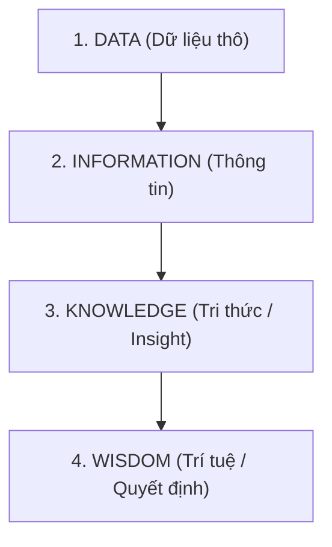

# BÁO CÁO PHÂN TÍCH DIKW & BI - XỬ LÝ SỰ CỐ ÁO KHOÁC DA Z101 (ZARA CHÂU Á)

**Kính gửi:** Giám đốc Vận hành (COO) & Ban Giám đốc Zara  
**Người thực hiện:** Chuyên gia Dữ liệu (Data Expert)  
**Ngày lập:** 29/09/2026 | **Định dạng:** Markdown (.md)  

---

## I. TỔNG QUAN PHÂN TÍCH THEO MÔ HÌNH DIKW

Để xử lý sự cố lô áo khoác da màu đỏ Z101 tại Châu Á có tỷ lệ hoàn trả bất thường, dữ liệu đầu vào được phân tách rạch ròi qua 4 cấp độ tháp DIKW:

1. **DATA (Dữ liệu thô):** Mã SP: Z101 | Danh mục: Áo khoác | Màu: Đỏ | Khu vực: Châu Á | Kênh: Online | Số lượng bán: 500 | Số lượng trả: 150 | Tỷ lệ trả lỗi khóa kéo: 85% | Phản hồi: *"Khóa ngược khó kéo, dễ kẹt"*.
2. **INFORMATION (Thông tin):** Tỷ lệ hoàn trả Z101 đạt **30,0%** (150/500), cao gấp 30 lần so với dòng sản phẩm an toàn Z102 Châu Âu (1,0%). Trong số 150 đơn trả, có tới **85% lý do đến từ lỗi khóa kéo**.
3. **KNOWLEDGE / INSIGHT (Tri thức):** Thiết kế khóa kéo ngược (Reverse Zipper) kết hợp với chất liệu da dày bị ma sát cao tại vùng khí hậu nóng ẩm Châu Á làm răng khóa dễ lệch và kẹt khi kéo nhanh ở vị trí ngực/cổ.
4. **WISDOM (Trí tuệ):** Ra quyết định điều hành tối ưu tài chính (Thu hồi & Thay khóa) và cải tiến quy trình thiết kế R&D.

---

## II. NHIỆM VỤ 1: RA QUYẾT ĐỊNH CẤP ĐỘ WISDOM

Dựa trên Insight thu được, tôi đề xuất 02 quyết định điều hành cụ thể:

### 🔴 Quyết định 1: Xử lý lô hàng Z101 đang tồn kho & thu hồi thị trường (Ngắn hạn)
* **Phương án chọn:** **THU HỒI & TÁI CHẾ CHẾ TÁC (RECALL & REWORK)**.
* **Hành động cụ thể:**
  * **Đóng băng tồn kho WMS/RFID:** Ngừng bán ngay 350 chiếc Z101 tồn kho và 150 chiếc đã bán (chủ động liên hệ thu hồi, hoàn tiền 100% kèm Voucher 20%).
  * **Sửa chữa thay thế (Rework):** Chuyển 500 chiếc áo về xưởng gia công Châu Á để **tháo bỏ cụm khóa kéo ngược và thay bằng cụm khóa kéo kim loại răng thưa tiêu chuẩn (Standard Metal Zipper)**.
  * **Tái tung ra thị trường:** Gắn mã Z101-R để bán xả hàng (Outlet), giúp thu hồi lại hơn **70% giá trị vốn nguyên vật liệu da đắt tiền**.

### 🔵 Quyết định 2: Áp dụng cho khâu R&D và Chuỗi cung ứng (Dài hạn)
* **Phương án chọn:** **CẢI TIẾN QUY TRÌNH THIẾT KẾ & TIÊU CHUẨN QC BẮT BUỘC**.
* **Hành động cụ thể:**
  * **Cấm áp dụng khóa ngược trên áo da Châu Á:** Ban hành quy định R&D chuẩn hóa: *Cấm sử dụng thiết kế khóa ngược (Reverse Zipper) trên tất cả sản phẩm Áo khoác Da/PU cho thị trường Châu Á*.
  * **Bổ sung bài kiểm tra QC:** Bắt buộc bộ phận R&D đưa chỉ số **"Mô-men lực kéo khóa trên chất liệu da trong môi trường độ ẩm 80%"** (tối thiểu 1.000 lần kéo thử nghiệm) vào danh mục QC bắt buộc trước khi phê duyệt sản xuất hàng loạt.

---

## III. NHIỆM VỤ 2: PHÂN BIỆT REPORT VÀ BUSINESS INTELLIGENCE (BI)

### 1. Bảng So sánh Cốt lõi trong bối cảnh Zara

| Tiêu chí phân biệt | REPORT (Báo cáo truyền thống) | BUSINESS INTELLIGENCE (BI) |
| :--- | :--- | :--- |
| **Bản chất vận hành** | **Thụ động (Passive)** & Mang tính lịch sử. | **Chủ động (Proactive)** & Mang tính hành động. |
| **Câu hỏi giải quyết** | *"Cái gì đã xảy ra?"* (What happened?) | *"Tại sao xảy ra & Cần làm gì tiếp theo?"* |
| **Tần suất truy xuất** | Theo định kỳ (Báo cáo cuối tuần / cuối tháng). | Theo thời gian thực (Real-time Streaming). |
| **Giá trị kinh doanh** | Thống kê con số tĩnh, ghi nhận sự việc đã rồi. | Phát hiện rủi ro sớm, tự động hóa quyết định (Wisdom). |

---

### 2. Định danh Hành động Cụ thể tại Zara

#### 📋 Hành động chỉ là "REPORT" (Giá trị thấp):
* **Hành động:** Định kỳ cuối tuần, chuyên viên xuất một file Excel tĩnh gửi Giám đốc Vận hành ghi:  
  *"Tuần này mã Z101 bán được 500 cái, bị trả 150 cái. Tỷ lệ hoàn trả là 30%."*
* **Hạn chế:** Khi báo cáo hoàn thành thì 150 khách hàng đã nhận trải nghiệm xấu, 350 áo tồn kho vẫn tiếp tục bị bán ra mà không có hành động ngăn chặn kịp thời.

#### 💡 Hành động đem lại giá trị "BI THỰC SỰ" (Giá trị cao):
1. **Cảnh báo tự động thời gian thực (Real-Time Anomaly Detection):** Ngay khi 10 chiếc Z101 đầu tiên bị trả lại trên kênh Online với lý do "Kẹt khóa", thuật toán BI tự động phát lệnh **Khóa kho WMS/RFID** cho 350 chiếc Z101 còn lại để chặn thiệt hại ngay từ ngày thứ 2.
2. **Đào sâu dữ liệu đa chiều (Drill-Down & Pattern Recognition):** Hệ thống BI tự động liên kết các chiều dữ liệu:  
   $$\text{Tỷ lệ trả Z101 (30\%)} \times \text{Lỗi khóa kéo (85\%)} \times \text{Kênh Online Châu Á}$$  
   So sánh đối chứng với Z102 (0% lỗi khóa), Z104 (5% lỗi khóa) để kết luận 100% nguyên nhân xuất phát từ lỗi thiết kế khóa ngược của R&D.
3. **Đề xuất quyết định hành động (Prescriptive Analytics):** Hệ thống BI tính toán sẵn bài toán chi phí: *So sánh giữa Thu hồi Sửa chữa (Thu hồi $35,000) và Hủy bỏ toàn bộ (Mất trắng $50,000)* để gợi ý quyết định tối ưu cho CEO.

---
*Báo cáo được trích xuất từ hệ thống BI & Analytics của Zara Châu Á.*
